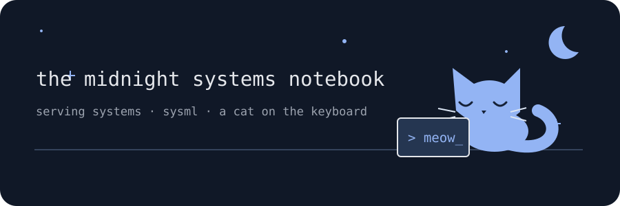

<div align="center">

# hi, i'm bhumika 🐈‍⬛

*usually down a systems rabbit hole. occasionally under a pile of books.*



[my little website](https://bhumika-chopra.github.io/) · [linkedin](https://www.linkedin.com/in/bhumika-chopra-740717165/) · [say hello](mailto:bhumika.chicago@gmail.com)

</div>

### currently in the notebook ✧

Somewhere between grad school and “wait, why is this slow?”, you'll find me pursuing my **MSCS at Georgia Tech** and interning at **[Avartha](https://avartha.ai/)**.

My favourite rabbit holes are **serving systems & SysML**. There's something very satisfying about all the little moving parts behind a model finally getting along.

### a few things the cat hasn't knocked off the desk

- 🧶 **[Setu](https://github.com/Bhumika-Chopra/setu)** — my recent contribution to distributed tensor exchange. Lots of moving pieces; that's the fun part. [Upstream](https://github.com/project-vajra/setu).
- 🐾 **[NanoGPT](https://github.com/Bhumika-Chopra/NanoGPT)** — a GPT-from-scratch detour, one token at a time.
- 🔎 **[Compiler Fault Localization](https://github.com/Bhumika-Chopra/CS-6390-PL-Fault-Localization)** — following ASTs and compiler clues into code complexity hotspots.

### things within paw's reach

```text
languages   C++ · Python · C · C# · Java · Julia
curiosity   serving systems · SysML
off-screen  novels · mentoring · “just one more chapter”
```

A good book recommendation or a conversation about systems is always welcome. The cat may supervise. 🐈
